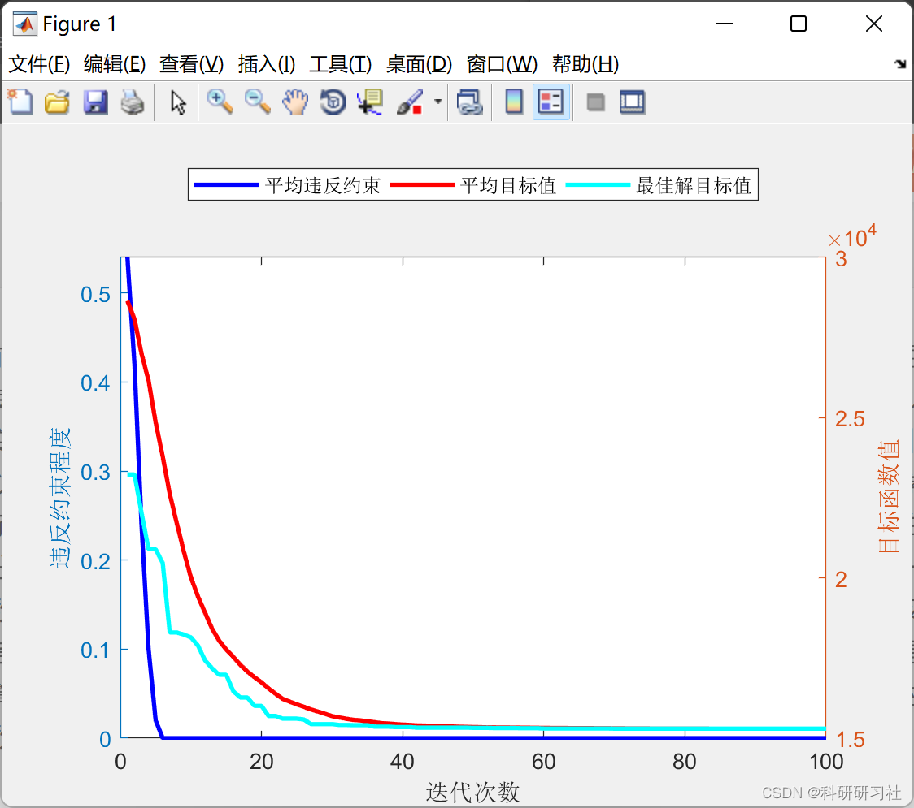
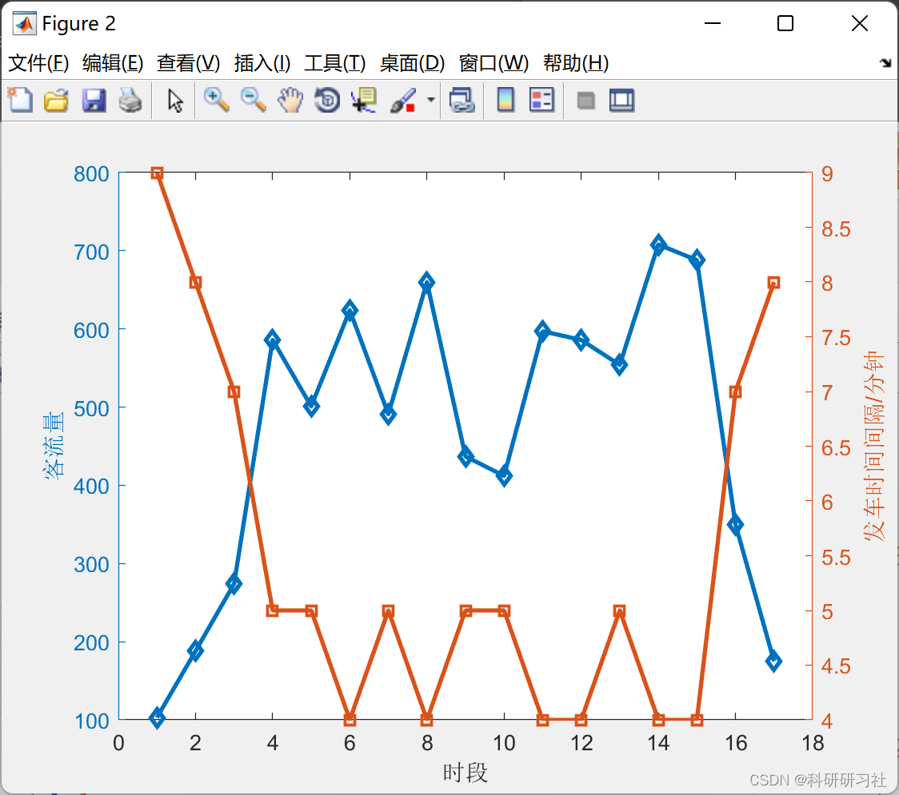
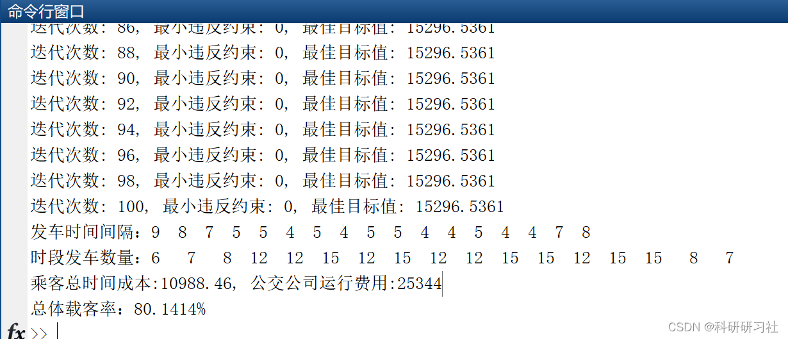

# [Optimization Scheduling] Research and Implementation of Bus Dispatch Scheduling Optimization Based on Genetic Algorithm (Matlab Code)

1. Overview of the current public transit dispatch system analysis, and the establishment of a mathematical model for bus scheduling. Based on the results of data mining analysis, this paper uses cross-sectional passenger flow data to constrain the model, thereby deriving the spatial distribution patterns of bus passenger travel. Using the departure interval as a decision variable, and with maximum departure interval, minimum departure interval, and vehicle load rate as constraints, a mathematical model for bus route scheduling is established. The objectives are to minimize the cost of bus company departures and the waiting time cost for passengers, establishing a dual-objective function model.
This paper designs an optimization solution for bus scheduling based on improved genetic algorithm, which optimizes the scheduling results through three stages: selection, crossover, and mutation. The improvements in selection involve designing a dynamic fitness function and adopting a method of multiple replication of superior individuals without replacement. For crossover, a new crossover operator is designed, taking into account that the quality of the initial and later groups may differ significantly, hence adjusting the crossover function accordingly. Mutation involves the introduction of the taboo search algorithm. Based on forecasted passenger flow, the model solves to determine the optimal schedule and the minimum number of vehicles required. Details can be found in Section 3.
2. Running Results
​
3. Matlab Code
This section only showcases part of the code, all codes and articles can be accessed by clicking the link: Research and Implementation of Bus Scheduling Optimization Based on Big Data (Matlab Code)
function Offspring = GA(Population)\nglobal bus\nN = length(Population);\nOffspring = Population;\nfor i=1:floor(N/2)\n    P1 = Population(2*i-1).decs;\n    P2 = Population(2*i).decs;\n    \n    [C1,C2] = Crossover(P1,P2);\n    C1 = Mutation(C1);\n    C2 = Mutation(C2);\n    \n    C1 = max(bus.minInterval,C1); C1=min(bus.maxInterval,C1);\n    C2 = max(bus.minInterval,C2); C2=min(bus.maxInterval,C2);\n    Offspring(2*i-1).decs = C1;\n    Offspring(2*i).decs = C2;\nend\n\nOffspring = CalObj(Offspring);\n  
Editor
4. References [1] Baozi Yang, Yu Jizhou, Yang Shan. Intelligent Optimization Algorithms and Their MATLAB Examples (2nd Edition) [M]. Electronic Industry Publishing House, 2016.
[2] Zhang Yan, Wu Shuigen. MATLAB Optimization Algorithm Source Code [M]. Tsinghua University Press, 2017.
​  

## Images

<!-- PAYMENT_BLOCK -->

## Get this dataset

- Payment link (Stripe): [Buy now](https://buy.stripe.com/3cs8yP7sY87d0vu9AB)
- Payment QR code: 

<!-- /PAYMENT_BLOCK -->
